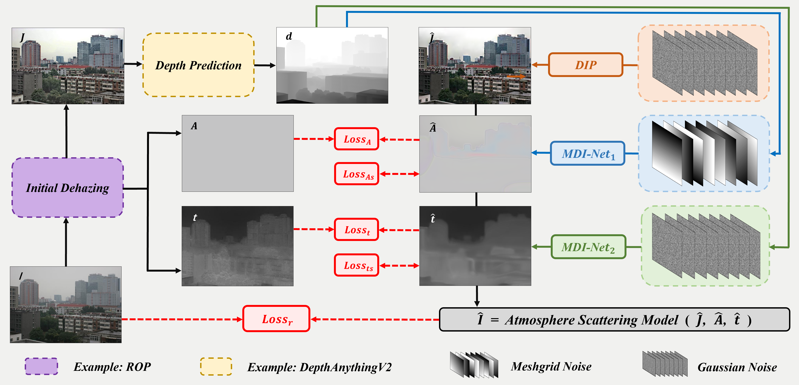
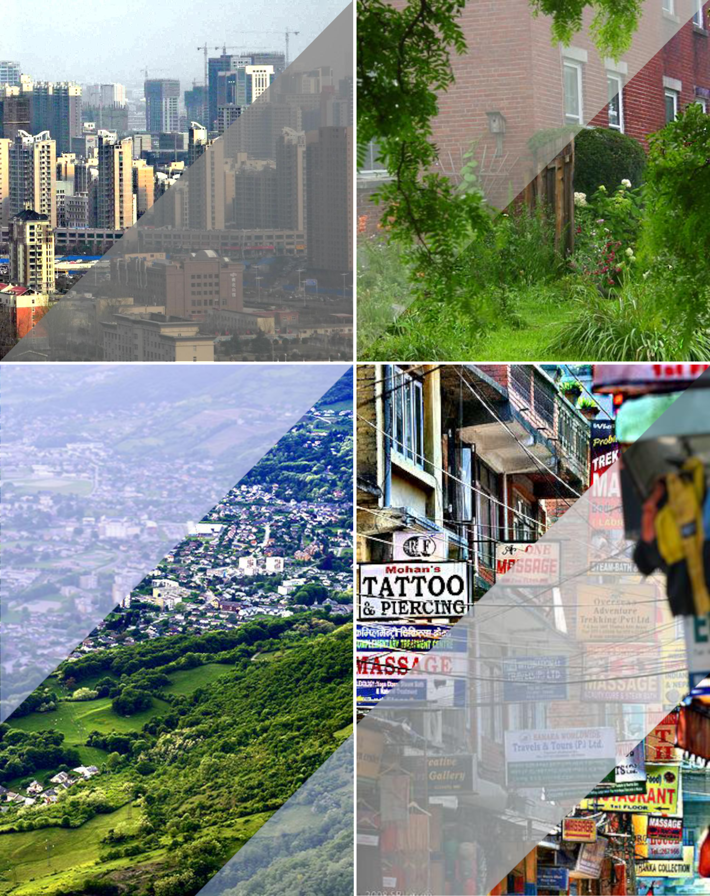
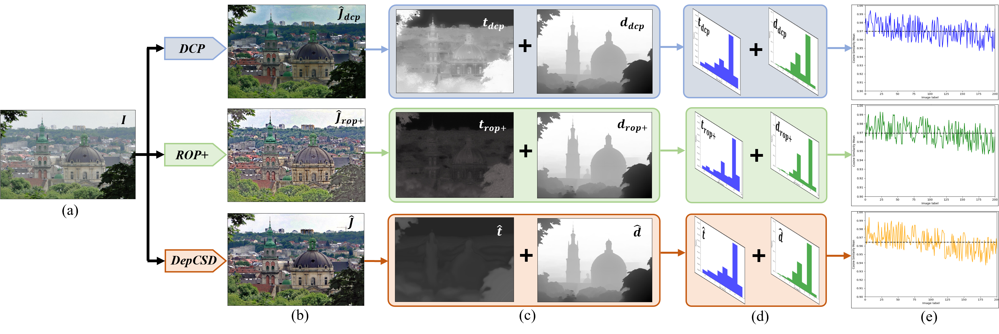
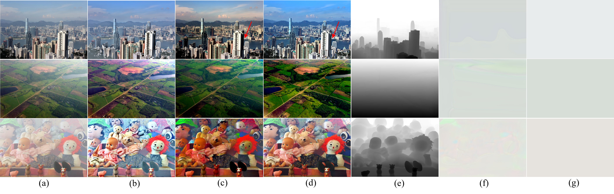
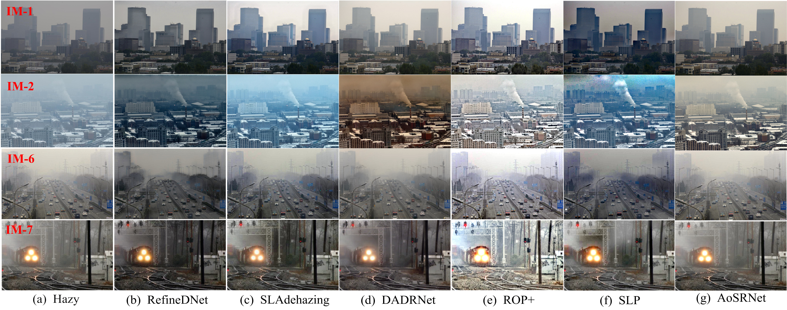
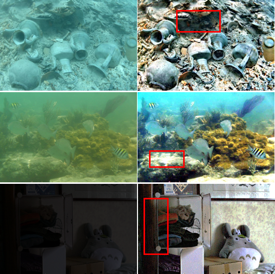

<div align="center">
<h1>DepCSD</h1>
<h2>Depth-Conditioned Self-Supervised Dehazing<br>for Real Scenes</h2>
<p>
  <strong>Xingkai Wen</strong> &nbsp;·&nbsp;
  <strong>Yingjie Liu</strong> &nbsp;·&nbsp;
  <strong>Ryan Wen Liu</strong><br>
  Liang-Jian Deng &nbsp;·&nbsp; Hao Liu &nbsp;·&nbsp; Jun Liu
</p>
<p><em>Physics-guided restoration · Depth-conditioned optimization · Real-world image dehazing</em></p>
<p>
  <a href="#installation"></a>
  <a href="#installation"></a>
  <a href="#installation"></a>
  <a href="#abstract"></a>
  <a href="#images"></a>
</p>
📖 Abstract   |   🧠 Framework   |   🖼️ Images   |   📦 Code   |   ⚙️ Installation   |   🚀 Run
<sub>This repository presents the DepCSD framework, paper visualizations and instructions for the accompanying inference code.</sub>
</div>
---
Abstract
In real-world image dehazing tasks, prior-based methods are constrained by handcrafted assumptions, while supervised deep learning methods face the inherent domain shift problem between the synthetic domain and real-world scenarios. To address the above challenges, this paper proposes DepCSD, a depth-conditioned self-supervised dehazing method. Different from existing self-supervised methods, DepCSD takes the depth information extracted from preliminary dehazing results as the geometric condition, embeds this prior into the joint optimization process of the transmission map, atmospheric light and clear image reconstruction under the Atmospheric Scattering Model (ASM), and achieves accurate fitting of each physical variable through the specially designed Multi-scale Depth-informed Network (MDI-Net). With this design, DepCSD effectively integrates the strong interpretability of physics-driven models with the high flexibility of self-supervised learning. In addition, the framework has excellent modular properties and is fully compatible with various initialization priors and State-of-the-Art (SOTA) depth estimation networks. Extensive experiments conducted on a variety of complex real-world hazy scenes verify that DepCSD achieves outstanding performance in terms of dehazing completeness, color fidelity, and robustness against complex scenarios. The source code and high-resolution images of this paper are available at: https://github.com/NENUpythoner/DepCSD.
<div align="center">
🧭 Depth conditioning	🔬 Physical modeling	🧩 Image-specific optimization
Geometric information from preliminary dehazing	Atmospheric scattering model	Self-supervision from the observed hazy image
</div>
Framework
<div align="center">
  
</div>
Figure 1. Overview of DepCSD. The hazy image is first processed by the initialization method to obtain a preliminary restoration, transmission map and atmospheric-light estimate. Depth prediction on the preliminary restoration supplies the geometric condition. Gaussian and meshgrid noise are used by the neural branches to fit the restoration variables, while the atmospheric scattering model constrains reconstruction of the observed image.
$$I(x)=t(x)J(x)+[1-t(x)]A(x),$$
where $I$ is the hazy image, $J$ is the clear image, $t$ is the transmission map and $A$ is atmospheric light.
Images
The image/ directory contains the high-resolution visualizations shown in the paper. Click an image to view its original file.
Paper visualizations
<p align="center">
  <a href="image/5.png"></a>
</p>
<p align="center">
  <a href="image/6.png"></a>
</p>
<p align="center">
  <a href="image/7.png"></a>
</p>
<details open>
<summary><strong>🌄 Landscape examples</strong></summary>
<br>
Example 1	Example 2
<a href="image/land1.png"></a>	<a href="image/land2.png"></a>
</details>
<details open>
<summary><strong>👥 People examples</strong></summary>
<br>
Example 1	Example 2
<a href="image/people1.png"></a>	<a href="image/people2.png"></a>
</details>
<details open>
<summary><strong>🔍 Additional examples</strong></summary>
<br>
Example 1	Example 2
<a href="image/ty1.png"></a>	<a href="image/ty2.png"></a>
</details>
<p align="center">
  <a href="image/12.png"></a>
</p>
Code
The accompanying hazy_plus inference package provides sequential folder processing:
Hazy images → original preprocessing → ROP+ initialization → depth prediction → DepCSD optimization → restored PNGs.
Component	Location
Main entry point	`dehazing_7_t1d1_hazy_plus.py`
Batch processing and resource paths	`depcsd_runtime.py`
Original network components	`net/`
ROP+ initialization	`Rop_plus/`
Depth interface and external model	`DepthAnything/`
Image operations and numerical utilities	`utils/`
Place the inference package contents at the repository root, alongside this README. All original `net/` and `Rop_plus/` source files are retained, including currently unused files.
> **Depth model setup:** the package includes the corrected `DepthAnything/run.py`. Supply the author's original complete `DepthAnything/depth_anything_v2/` source tree and the matching checkpoint separately. Do not replace the corrected wrapper with the upstream general-purpose CLI. Datasets, virtual environments and large model weights are not included in the source package.
Installation
1. Create the environment
The inference package targets Windows x64, Python 3.10 and an NVIDIA CUDA GPU. The complete DepCSD program does not support CPU inference.
Run the following in PowerShell. Replace the example project directory with your actual path:
```powershell
conda create -n depcsd python=3.10.16 pip -y
conda activate depcsd
Set-Location "D:\Projects\DepCSD"
python -m pip install -r .\requirements.txt
python -m pip check
```
An existing environment with the same dependencies can be reused.
<details>
<summary><strong>🌐 Slow downloads? Install PyTorch and ordinary dependencies separately.</strong></summary>
Use the files supplied in the inference package. If the matching torch/torchvision versions are already installed, skip the first command.
```powershell
python -m pip install "torch==2.5.1+cu121" "torchvision==0.20.1+cu121" --index-url https://download.pytorch.org/whl/cu121 --no-deps --timeout 120 --retries 5
python -m pip install -r .\requirements-mirror.txt -i https://pypi.tuna.tsinghua.edu.cn/simple --only-binary=:all: --timeout 30 --retries 1
python -m pip check
```
The first command alone is incomplete: the second resolves the remaining dependencies. `requirements-mirror.txt` preserves the package pins and removes only the extra-index directive.
</details>
2. Prepare the depth model
Restore the author's original complete `depth_anything_v2/` source tree under `DepthAnything/`, retaining its upstream license files. Keep the corrected `run.py` supplied in the inference package. Place the matching pretrained weight at:
```text
DepthAnything/checkpoints/depth_anything_v2_vitl.pth
```
The original wrapper defaults to vitl and an input size of 518. Depth Anything V2 provides upstream source/model information; use the source version and checkpoint matching the original implementation, and follow their respective licenses.
3. Check the setup
```powershell
Test-Path .\DepthAnything\depth_anything_v2\dpt.py
Test-Path .\DepthAnything\checkpoints\depth_anything_v2_vitl.pth
python -c "from depcsd_runtime import preflight; preflight()"
```
Both path checks should return `True`. Preflight checks basic CUDA computation and imports the depth function; it does not yet load the checkpoint or run depth prediction.
Run
From the directory containing the main Python file, specify only the input and output folders:
```powershell
python .\dehazing_7_t1d1_hazy_plus.py --input "D:\Data\DepCSD_input" --output "D:\Results\DepCSD_outputs"
```
If both folders are next to the main file:
```powershell
python .\dehazing_7_t1d1_hazy_plus.py --input ".\DepCSD_input" --output ".\DepCSD_outputs"
```
Setting	Default behavior
Input	Current folder level; `.png`, `.jpg`, `.jpeg`
Image type	Single-frame 8-bit RGB/RGBA; alpha is dropped
Optimization	3000 Adam iterations per image; learning rate 0.001
Diagnostic interval	Every 100 iterations
Final brightness exponent	2/3
Main output	Original filename stem, with `.png` extension
Output example
Input	Main output
`DepCSD_input/0036.png`	`DepCSD_outputs/0036.png`
`DepCSD_input/scene.jpg`	`DepCSD_outputs/scene.png`
Intermediate outputs are stored under `_debug/<original-filename>/`. The latest `run_manifest.json` records image status, dimensions and errors. Re-running recomputes and replaces corresponding results.
Resolution: main outputs keep the decoded input's pixel width and height. The original center crop remains; selected RGB results are resized only when exported. Matching dimensions do not restore cropped borders. Other diagnostic maps keep their original working/cropped dimensions.
Use separate, non-nested input/output folders. Separate same-stem inputs such as `scene.jpg` and `scene.png` before running, because both would produce `scene.png`.
> **Reproducibility note:** paper images above are existing manuscript illustrations. The source package has undergone syntax/unit checks and short instrumented tests with simulated depth. Real depth weights, a full 3000-step CUDA run and paper benchmark results have not been verified in the packaging environment.
Citation
If you find this work useful, please consider citing the manuscript. Publication metadata will be updated when available.
```bibtex
@misc{wen2026depcsd,
  title  = {Depth-Conditioned Self-Supervised Dehazing for Real Scenes},
  author = {Wen, Xingkai and Liu, Yingjie and Liu, Ryan Wen and Deng, Liang-Jian and Liu, Hao and Liu, Jun},
  year   = {2026},
  note   = {Manuscript},
  url    = {https://github.com/NENUpythoner/DepCSD}
}
```
---
<div align="center">
  <strong>DepCSD</strong> · Geometry meets self-supervised image restoration<br>
  <sub>Source and checkpoint licenses should be checked separately.</sub><br><br>
  <a href="#">⬆ Back to top</a>
</div>
